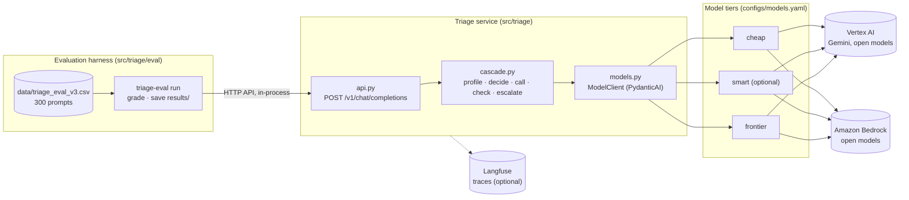
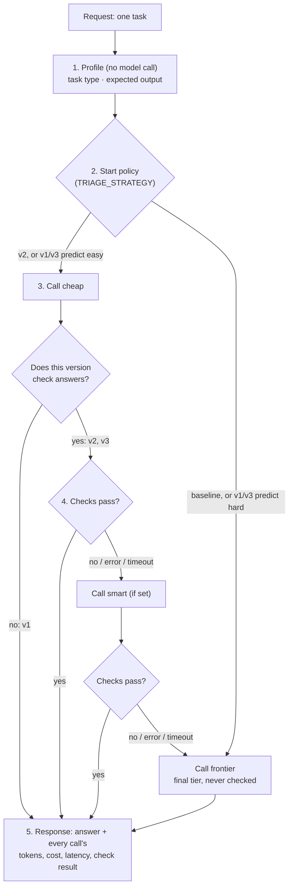

# Triage architecture

A service that sends each task to a cheap model or a frontier model, to cut cost without losing quality.
We build four versions of it and compare them on 300 prompts against always using the frontier model.

Diagrams: `docs/diagrams/triage-architecture.excalidraw` (open at excalidraw.com).
Status markers: **built** = in the code and tested; **stub** = interface exists, logic not written;
**planned** = not started.

## 1. The four versions

| Version | First tier | Checks the answer and escalates | Status |
|---|---|---|---|
| `baseline` | always frontier | no, the answer is final | built |
| `v1` rules | task-type rules: cheap for math, classification and named-field extraction; a cost rule for long extractions; frontier otherwise | no | built |
| `v2` escalate | always cheap | yes, one tier up on fail or timeout; checks chosen per task type | built |
| `v3` classifier | always cheap | yes: a logistic model over the cheap answer's signals escalates when the estimated frontier cost per fixed answer is within a limit | built |

All four run in the same service. The version is set when the service starts (`TRIAGE_STRATEGY`); callers
never choose it. Baseline is the reference every other version is measured against.

## 2. System overview

- The service is one FastAPI app. The harness is separate and reaches it only through its HTTP API (the
  app runs in-process, so no server is needed). Expected answers stay in the harness; only prompts are sent.
- Model tiers are slots. Which model fills each slot is configuration, and any tier can be on either cloud.

## 3. What happens to a request

## 4. API

OpenAI chat-completions format, single-shot: one task in, one answer out.

**Request** (`POST /v1/chat/completions`)

| Field | Required | Meaning |
|---|---|---|
| `model` | yes | Required by OpenAI clients; any value is accepted and ignored. |
| `messages` | yes | Exactly one `user` message with the whole task, optionally preceded by one `system` message. |
| `metadata.task_type` | no | Hint (`document_qa`, `contract_extraction`, `coding`, …). Inferred when absent. |
| `temperature`, `max_tokens` | no | Passed unchanged to whichever tier answers. |
| multi-turn, `stream`, `tools`, `n > 1` | — | Rejected with 400. |

**Response:** the standard OpenAI fields (`choices`, `usage` summed over all calls) plus a `triage` block:
version, profile, start decision, escalation path, every call (tier, provider, model, tokens, cost,
latency, retries, error, check result) and totals (cost, wasted cost, overhead cost, latency).

**Errors** use the OpenAI error shape: 400 bad or unsupported request, 501 version not implemented yet,
502 the final model call failed (the body still includes the calls, so spend is recorded), 503 the version
needs a tier with no model assigned (`tier_not_configured`).

**Eval mode** (`TRIAGE_EVAL_MODE=true`): the harness can pick the version per request with the
`X-Triage-Strategy` header, and every call's answer text is returned so rejected answers can be scored.
`X-Triage-Eval-Run`, `-Item` and `-Repeat` tag the request's trace with its run, dataset item and run number.
All of this is off by default.

## 5. Code layout

| Module | Does | Status |
|---|---|---|
| `api.py` | HTTP endpoint, request validation, response and errors | built |
| `schemas.py` | Request, response and internal types | built |
| `config.py` | Settings from `.env`, loading `configs/*.yaml` | built |
| `profile.py` | Reads the task before any call, from any prompt layout: the document, the ask, task type, expected output, listed labels | built |
| `policies.py` | Picks the first tier. v1: task-type rules plus a cost rule, frontier by default, every matching rule reported | built |
| `features.py` | Prompt signals for the v1 rules: task type, estimated length, named fields vs span list | built |
| `escalation.py` | v3: signals of a cheap answer, the logistic model, the cost-aware escalation rule and the `escalation_model` check | built |
| `cascade.py` | The loop in section 3, totals, request log line | built |
| `models.py` | Calls one tier: timeout, retries, tokens, cost | built |
| `providers.py` | Builds a model from a catalog entry: Vertex Gemini, Vertex open models, Bedrock, fake | built |
| `checks.py` | Failure checks, no answer key: `non_empty`, `refusal`, `json_format` (JSON, label, number, Python and SQL that parse), `grounding`, `span_count`, `examples` (runs the prompt's examples), `agreement` (a second cheap answer must match), `cross_agreement` (a second model's answer must match); `self_report`, `judge` are stubs | built |
| `sandbox.py` | Runs model-written code in a limited subprocess (no network block): graders and the `examples`/`agreement` checks | built |
| `tracing.py` | Langfuse: one `route-request` trace per request, model calls and checks inside | built |
| `smoke.py` | `uv run triage-smoke`: pings every catalog model | built |
| `eval/graders.py` | One grader per dataset check type; LLM judge for rubric items | built |
| `eval/train_classifier.py` | Trains the v3 classifier on a cheap-model run vs the baseline; picks the escalation limit on held-out documents | built |
| `eval/offline.py`, `eval/rules_report.py`, `eval/checks_report.py` | Replay routing on saved answers and score v1 and the v2 check lists, with no model calls | built |
| `eval/retemplate.py`, `eval/external.py` | Re-worded eval prompts and an external test set from five other public datasets | built |
| `eval/harness.py`, `eval/cli.py` | `triage-eval`: runs a version over the dataset, grades, saves `results/` | built |
| `eval/synthetic.py` | Generates the 40 synthetic prompts from templates, with computed answers | built |
| `eval/build_dataset.py` | Builds `triage_eval_v3.csv`: public prompts minus 40, plus synthetic | built |

Configuration lives in `configs/models.yaml` (catalog and tier slots) and `configs/strategies.yaml`
(versions and their checks), not in code.

## 6. Models

- **Catalog:** 17 candidate models, each with provider, model ID, price and the date it last passed the
  smoke test. Grouped by role: open ~7–20B on Bedrock (cheap candidates), open ~70–250B on Bedrock and
  Vertex (smart candidates), Gemini on Vertex (frontier candidates: Gemini 4 Argon, 3.1 Pro Preview,
  3.8 Flash).
- **Tier map:** `tiers: cheap / smart / frontier` names which catalog entry fills each slot. Frontier is
  Gemini 4 Argon (GA, the strongest model we can reach); cheap is not chosen yet; smart is optional. Only
  frontier is required to start on real models; a version that needs an empty slot gets a 503.
- **Reasoning:** one effort level per experiment, `TRIAGE_REASONING` (or `triage-eval --reasoning`) = low,
  medium or high, applied to every reasoning model in the tiers. A model with `reasoning_levels` in the
  catalog refuses to run without it, so no experiment uses a model's own default. Checked live on
  2026-10-27: Gemini 4 Argon, gpt-oss-20b and gpt-oss-120b honour it (thinking tokens rise low → high).
  Nemotron ignores it (and nano-9b leaks `</think>` into answers); Qwen3-235B-2507 does not reason. The
  level is recorded per call and in every run's manifest; answers cut off at `max_tokens` are flagged
  `truncated` and counted in the summary.
- **Providers:** `vertex_gemini` (Gemini), `vertex_maas` (open models on Vertex), `bedrock` (open models),
  and `fake` (scripted models for tests).
- **Prices:** USD per 1M tokens, standard on-demand rates, fetched 2026-10-27 from the AWS Price List API
  (us-east-2) and the Vertex AI pricing page. Reasoning models bill their thinking as output: Gemini Pro
  models used 300–2,000 output tokens on one-line questions. Gemini 4 Argon's price doubles on 2026-12-01,
  so the frontier baseline should run before then.
- **Keys:** read from `.env` only (`GOOGLE_API_KEY`, `GOOGLE_CLOUD_PROJECT`, `AWS_BEARER_TOKEN_BEDROCK`,
  `AWS_REGION`; optionally `LANGFUSE_*` for tracing). No cloud login is needed. `.env` is git-ignored; `.env.example` lists the names.
- **Fake backend** (`TRIAGE_BACKEND=fake`, the default): cheap and frontier are scripted, so tests and
  development need no keys. Markers in a prompt script failures: `[fake:fail]` empty answer,
  `[fake:error]` cheap/smart error, `[fake:down]` every tier errors.

## 7. Behaviour worth knowing

- **Retries:** only temporary failures are retried (timeouts, network errors, HTTP 408/429/5xx), with
  backoff. Auth errors, bad requests and models not enabled (400/401/403/404) fail at once and escalate.
- **Empty answers:** PydanticAI by default re-asks a model that returns no text, which is a hidden, billed
  call. That is turned off (`retries=0`): an empty answer is kept with its tokens and fails the checks.
- **Frontier is final:** its answer is returned unchecked. If it errors, the request returns 502.
- **Cost:** our own number, the tokens each call reports × the catalog price. It is what the API returns and
  what the report uses. Thinking tokens are included (checked on Argon). Provider cache discounts are
  ignored on purpose, as if every prompt were new, so the real bill can be lower. Failed calls report no
  tokens and count as $0. `cost_complete` is false when an answered call's model has no price.
- **Logging:** one line per request (version, task type, path, cost, latency) and a warning per failed call.
- **Tracing:** with Langfuse keys set, each request is a `route-request` trace with every model call as a
  generation and every check as a `check-answer` guardrail. `TRIAGE_TRACE_CONTENT=false` sends no prompts
  or answers; tests never trace. Langfuse computes its own cost, which can differ from ours when a prompt
  was cached.

## 8. Extending it

- **A check:** write `async def my_check(ctx: CheckContext) -> CheckResult` in `checks.py`, add it to
  `CHECKS`, and list it under a version's `checks:` in `configs/strategies.yaml`. A check that needs a model
  calls `await ctx.ask_model(prompt)`; that call is logged as `purpose: "judge"` and counted as overhead.
- **v1 rules:** `_STAY_CHEAP` in `policies.py`, each a named condition on the prompt signals; a match sends
  the request to cheap, anything else goes to frontier. `rules.min_saving_usd` in `configs/strategies.yaml` is
  the cost rule's threshold. Re-score with `uv run python -m triage.eval.rules_report`.
- **v2 checks:** compare check lists on saved answers with `uv run python -m triage.eval.checks_report`.
- **v3 classifier:** retrain after a new cheap model or dataset with
  `uv run python -m triage.eval.train_classifier --cheap-run results/cheap-<model>`; it writes
  `artifacts/escalation.json` (set in `configs/strategies.yaml`) and picks `max_usd_per_fix` on held-out
  documents.
- **Cheaper eval runs:** `triage-eval run --strategy v3 --reuse-frontier baseline-low` reuses the baseline's
  saved frontier answer (same prompt and repeat) whenever a router escalates.
- **A model:** add a catalog entry, run `uv run triage-smoke <name>`, set `tested:`.
- **A provider:** add a builder in `providers.py` and a value to `Provider` in `config.py`.

## 9. Evaluation

**Built:** `uv run triage-eval run --strategy baseline --runs 3` sends every prompt through the service
in-process (eval mode), grades each answer and writes `results/<run-id>/`: `manifest.json` (version, each
tier's model, settings and price, judge, dataset hash, git commit), `calls.jsonl` (answer + triage block per
prompt and run), `grades.jsonl`, `summary.json`. Rerunning the same `--name` resumes; `--max-cost` caps
spend; `triage-eval regrade` re-grades saved answers without model calls. Each run is one Langfuse session.
The summary splits results by use case and by public vs synthetic. Latency is taken from run 1 only: runs 2
and 3 repeat the same prompts minutes later, and Gemini caches repeated prompts automatically, which would
make them look faster than real traffic.

**Why 3 runs:** the same model can answer the same prompt differently. Three runs show how stable a result is,
give the confidence intervals, and define the difficulty labels below.

**Planned:**

1. **Pilot** (~30 prompts) at low / medium / high to choose the levels for the full runs.
2. **Baseline:** Argon on all 300 prompts × 3 runs, at low and high reasoning, before 2026-12-01.
3. **`--tier` runs:** cheap (and smart) answer every prompt directly, 3 runs. These give:
   - **difficulty labels:** a prompt is easy if the cheap model answered it correctly in all 3 runs. They train
     v3 and define router accuracy; the dataset's human labels are reported alongside;
   - **big vs small models on public vs synthetic prompts** (asked for by H3L).
4. **Tuning:** v1 rules, the v3 threshold and the checks, on training folds only. Splits are grouped by source
   document, and one task type is held out.
5. **Version runs:** v1, v2, v3 through the API, 3 runs per prompt. In eval runs, a frontier call reuses the
   baseline's saved answer for the same prompt and run (with its original cost and latency) instead of
   calling Argon again. These are the reported numbers.

**Metrics** (design note): quality against the expected answer; cost per correct answer (all spend, failed
attempts and judge calls included); latency p50 and p95 (run 1); failure rate (errors, timeouts, empty
answers); router accuracy (hard sent to cheap, easy sent to frontier; difficulty label); escalation rate per
hop; wasted cost; routing overhead.

**What we report:** no pass/fail target. For each version against frontier-only: the cost-per-correct vs
quality chart with the point where routing matches baseline quality marked; savings and quality difference
with 95% confidence intervals; the same per use case; where routing breaks down; which version we would
deploy; public vs synthetic. "Matches baseline quality" means the 95% CI on the paired quality difference
includes zero. The synthetic slice is 40 prompts, so its intervals are wide (roughly ±15 points).

## 10. Data

`data/triage_eval_v3.csv`: 300 prompts, each with an expected answer, a check type and an easy/hard label:
260 public + 40 synthetic. Built by `uv run python -m triage.eval.build_dataset` from the 300 public prompts
in `data/triage_eval_v2.csv` (40 dropped at random per use case, never the handwritten ones; ids in
`data/triage_eval_v3_dropped.txt`) and the synthetic prompts from `triage.eval.synthetic`.

| Use case | Prompts | Easy / hard | Sources |
|---|---|---|---|
| Document Q&A | 90 | 52 / 38 | SQuAD 2.0 (68), handwritten (10), synthetic (12) |
| Contract extraction | 90 | 47 / 43 | CUAD (68), handwritten (10), synthetic (12) |
| Coding | 90 | 45 / 45 | MBPP (54), HumanEval (14), handwritten (10), synthetic (12) |
| Off-distribution | 30 | 21 / 9 | GSM8K (12), Banking77 (11), handwritten (3), synthetic (4) |

**Synthetic prompts** are written for this project (invented memos, contracts with schedules about as long as
CUAD's, invented code specs) so no model can have trained on them. They copy the instruction wording of the
public items they mirror, are 6 easy / 6 hard per main use case, and every answer is computed by the
generator and checked by tests. Results are reported for public and synthetic separately.

Labels, expected answers and check types are evaluation-only; they are never sent to the service.

## 11. Decisions

- **One service, in-process cascade.** Simplest thing that meets the brief; strategies share identical
  infrastructure, so the comparison is fair.
- **OpenAI chat format, single-shot.** The standard most clients already speak; the tasks are one-shot.
- **Version set by config, not by the caller.** Choosing the model is the router's job.
- **PydanticAI as a thin model layer.** One interface across Vertex and Bedrock, token usage, typed output,
  test models. Agent features are not used.
- **No workflow orchestrator.** The evaluation is a linear pipeline run a few times; a resumable CLI that
  saves every answer is enough.
- **Models on both clouds, keys only.** Gemini on Vertex AI, open models on Bedrock; no cloud login.
- **Our own cost, cache discounts ignored.** Every version is priced the same way, as if prompts were new;
  Langfuse's cost is for viewing, not reporting.
- **Latency from run 1.** Repeats can be served from the provider's cache.
- **40 synthetic prompts, 300 total.** Generated from templates (no model can have seen them), in the same
  formats as the public items they mirror, so public vs synthetic differs only in seen vs unseen.
- **Langfuse optional.** Tracing is for looking at what the router did; results never depend on it.

## 12. Not built yet

the `self_report` / `judge` checks, a smart tier, reusing
baseline answers for frontier calls in eval runs, the comparison report, a check of the rubric judge against hand grades, running the code
sandbox in a container, endpoint authentication, deployment.
